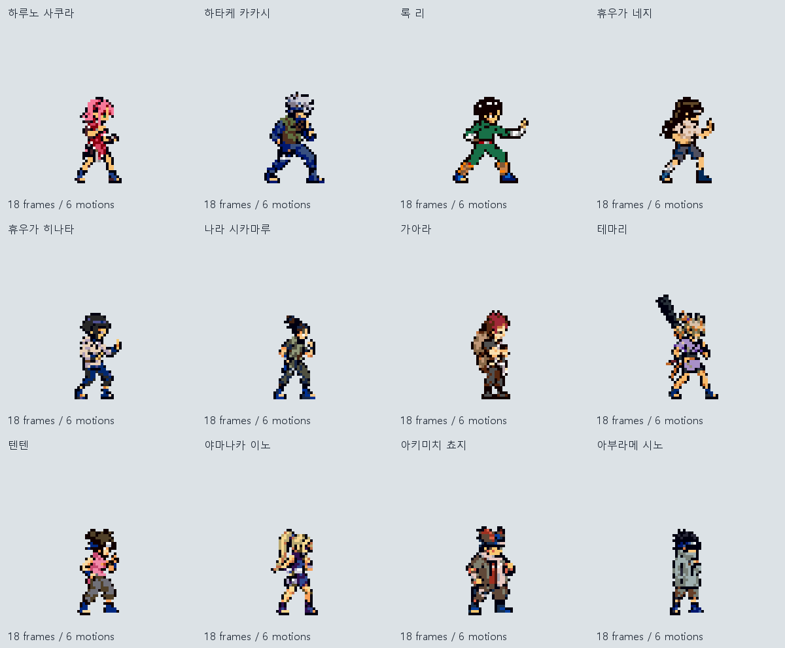
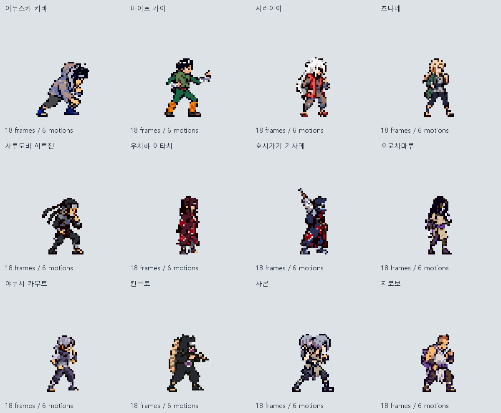
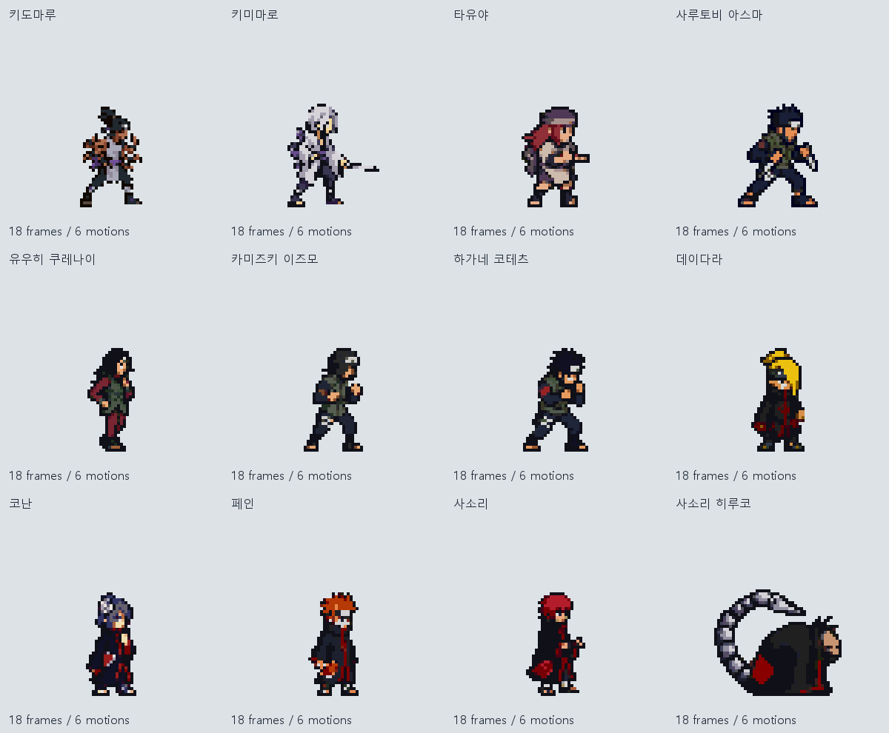
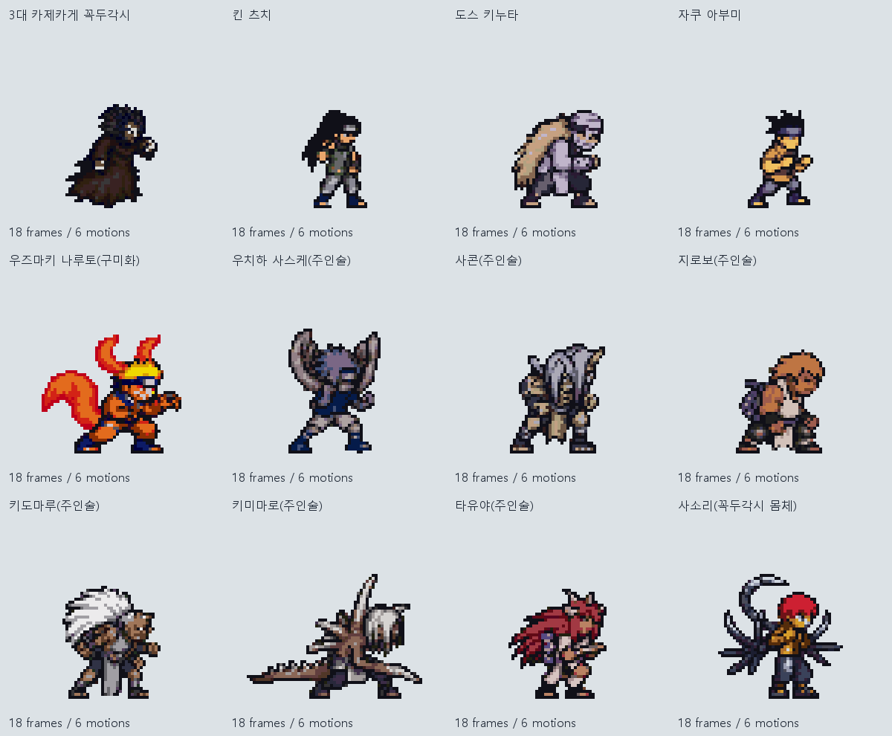
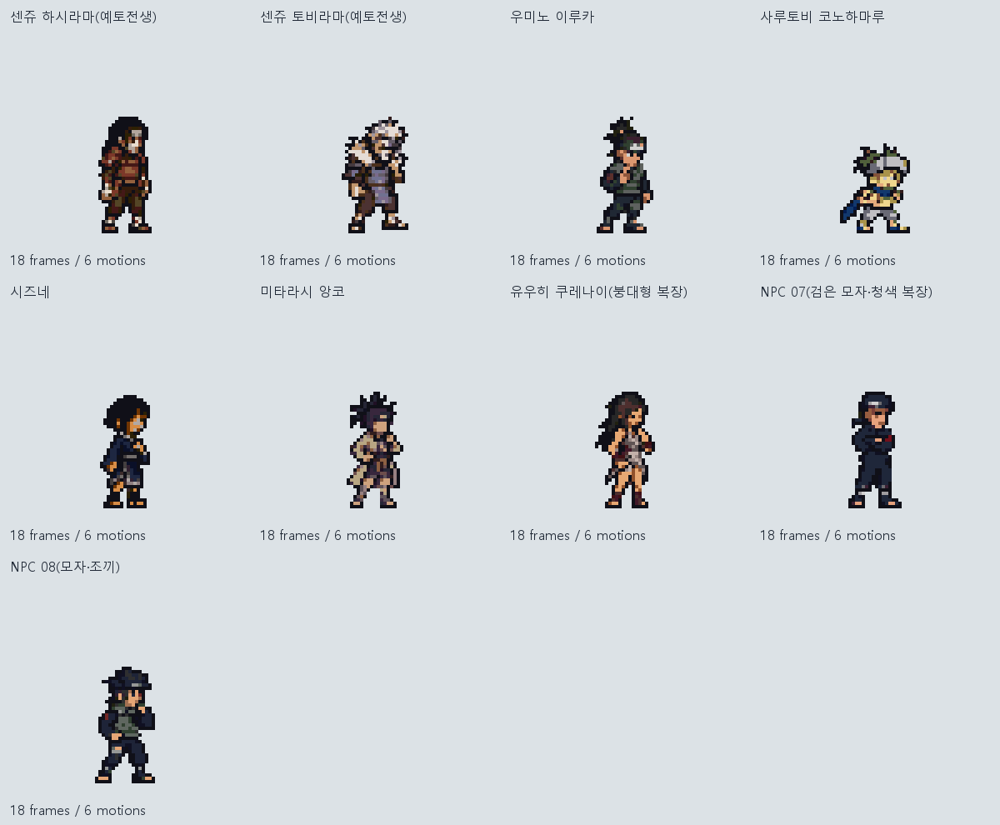

# 전투 스프라이트 제작 데이터 보존 — 2026-10-15

현재까지 제작한 **4,404개 파일**(약 226MB)을 저장한 브랜치입니다. 전체 보존본은 파일 구조를 유지한 분할 ZIP으로 저장했습니다.

## 전체 제작 데이터 복원

1. 이 브랜치를 Clone하거나 GitHub의 **Code → Download ZIP**으로 내려받아 압축을 풉니다.
2. `제작결과` 폴더에서 다음을 실행합니다(Python 3.9 이상, 외부 라이브러리 불필요).

```powershell
python restore_snapshot.py
```

`제작결과/restored`에 원래의 `outputs`, `pipeline/work`, 설명과 검증 목록이 복원됩니다. 스크립트는 분할 파일, 합친 ZIP, 복원된 파일의 SHA-256을 검증합니다. 기본 복원 폴더는 비어 있어야 합니다. 경로를 지정하려면 `--destination <빈 폴더 경로>`를 사용하세요.

복원 후 `outputs/Main_GBA_Batch_v1/index.html`을 브라우저에서 열면 동작별 전체 갤러리를 확인할 수 있습니다.

## 빠른 다운로드

[주요 캐릭터 게임용 경량 ZIP](downloads/Main_GBA_GameAssets_v1.zip): 주요 캐릭터/변형/NPC **57세트 · 1,026프레임**, 돼지 NPC **5프레임**, 시트·팔레트·발 기준점·타이밍 메타데이터. 생성 원본과 미리보기 등 전체 자료는 분할 보존본에 있습니다.

## 전체 보존본의 내용

- 주요 캐릭터 GBA풍 57세트, 범용 캐릭터 10세트, 현재 그림체의 나루토·사스케, 돼지 NPC.
- 개별 투명 PNG, 스프라이트 시트, GIF 미리보기, 생성 원본, 프롬프트, 팔레트, 메타데이터와 검증 기록.
- 초기 나루토/SFC 비교안, 나선환, 이전 범용 닌자 시험안, 장비 제안과 참고 분석.
- 제작 당시 사용한 Python 스크립트와 설정 JSON(과거 버전용도 포함).

동일 데이터를 중복하는 기존 ZIP, 다운로드한 참고 원본 캐시, 임시 작업 이미지와 base64 캐시는 제외했습니다. [보존 파일 목록](FILE_INVENTORY.json)과 [분할 ZIP 검증 목록](backup/manifest.json)을 제공합니다.

스프라이트는 **제작 기준안·애니메이션 초안**입니다. 게임 엔진 재생 검증과 최종 도트 정리는 별도이며, 인술 효과/투사체는 캐릭터 동작과 분리합니다. 일부 NPC 이름은 원본에서 확정되지 않아 번호로 보존했습니다.

## 주요 캐릭터 전체보기










